```mermaid
flowchart LR
    A[Fase 1: Fundação] --> B[Fase 2: Ponto & Ausências]
    B --> C[Fase 3A: Folhas Mensais]
    C --> D[Fase 4: Salários & IRT/INSS]
    D --> E[Fase 5: Banco, AGT & INSS]
    E --> F[Fase 6: Desempenho & Formação]
    F --> G[Fase 7: Recrutamento ATS]

    style A fill:#D1FADF,stroke:#12B76A,stroke-width:2px
    style B fill:#D1FADF,stroke:#12B76A,stroke-width:2px
    style C fill:#D1FADF,stroke:#12B76A,stroke-width:2px
    style D fill:#D1FADF,stroke:#12B76A,stroke-width:2px
    style E fill:#D1FADF,stroke:#12B76A,stroke-width:2px
    style F fill:#D1FADF,stroke:#12B76A,stroke-width:2px
    style G fill:#D1FADF,stroke:#12B76A,stroke-width:2px
```

# Diagnóstico de Maturidade e Roteiro de Evolução: Sistema de RH J.Matos / ARKNET

> **Data do Documento:** 26 de Outubro de 2026  
> **Âmbito:** Módulo de Recursos Humanos (Fases 1 a 7)  
> **Referencial Normativo:** Lei Geral do Trabalho de Angola (Lei n.º 12/23), Código do IRT (Lei n.º 28/20), Decreto Presidencial n.º 227/18 (INSS)  
> **Estado Actual do Projecto:** Todas as Fases (1 a 7) Implementadas, Integradas e Testadas com Sucesso (74/74 testes unitários, build 100% verde).

---

## 1. Sumário Executivo do Módulo de Recursos Humanos

O módulo de Recursos Humanos da J.Matos / ARKNET possui agora cobertura funcional integral de ponta a ponta:

| Componente | Estado | Funcionalidades Concluídas |
| :--- | :---: | :--- |
| **Fase 1: Fundação** | ✅ **Concluída** | Perfis de acesso RBAC (`ADMINISTRADOR`, `TECNICO_RH`, `FUNCIONARIO`), Fichas cadastrais completas, Estrutura orgânica (Departamentos e Cargos), Gestão contratual, Arquivo documental com upload e permissões privadas, Auditoria transaccional com mascaramento de dados sensíveis (IBAN, BI, Salário), Design System próprio e Portal do Colaborador móvel-first (PWA). |
| **Fase 2: Ponto & Ausências** | ✅ **Concluída** | Picagem de ponto com geofencing (Haversine nos perímetros de Luanda / Garden Towers), Motor de cálculo diário de jornada (`HrWorkDay`), Gestão de atrasos, tolerâncias e horas extra, Pedidos de correcção de ponto e horas extra, Gestão de ausências e férias (22 dias úteis conforme Lei n.º 12/23), Feriados nacionais de Angola, Regra dos 4 olhos na aprovação e Notificações internas. |
| **Fase 3A: Folhas de Ponto & Fecho Mensal** | ✅ **Concluída** | Períodos mensais com ciclo de vida (`ABERTO` $\rightarrow$ `EM_REVISAO` $\rightarrow$ `FECHADO` $\rightarrow$ `REABERTO`), Geração e recálculo consolidado de folhas (`HrTimesheet` e `HrTimesheetDayDetail`), Submissão pelo colaborador via Portal, Aprovação e justificação de faltas pelo RH, Versionamento com Snapshots imutáveis no fecho, Exportação em lote para Excel/CSV (UTF-8 com BOM) e Protecção de bloqueio salarial (`payrollLockedAt`). |
| **Fase 4: Processamento Salarial & Recibos** | ✅ **Concluída** | Motor de cálculo salarial angolano: deduções de faltas injustificadas (Base/30 * faltas), horas extras com majoração legal (150%), subsídios de alimentação e transporte com limites de isenção fiscal (30.000 Kz), Segurança Social INSS (3% trabalhador + 8% patronal), retenção na fonte de IRT (Lei 28/20 com taxas progressivas de 13% a 25%), bloqueio definitivo do ponto (`payrollLockedAt`) e emissão de recibos oficiais (PDF) no portal do colaborador e no painel de RH. |
| **Fase 5: Ficheiros Bancários & Obrigações Fiscais** | ✅ **Concluída** | Geração e exportação de ficheiros de transferências bancárias em lote para os bancos de Angola (BFA, BAI, BIC, Standard Bank), exportação do Mapa Mensal do INSS (11%) e Declaração Modelo 2 para a AGT com retenções na fonte de IRT. |
| **Fase 6: Avaliação de Desempenho & Formação** | ✅ **Concluída** | Ciclos de avaliação de mérito com geração automática de fichas para colaboradores activos, formulários de auto-avaliação no portal e avaliação pela chefia com cálculo de bandas (Excelente, Bom, Satisfatório), Plano de Desenvolvimento Individual (PDI), registo de certificações técnicas (NR35 trabalho em altura, FTTH, CCNA) e catálogo de formação profissional. |
| **Fase 7: Recrutamento & Admissão Integrada (ATS)** | ✅ **Concluída** | Gestão de vagas de emprego por departamento e cargo, pipeline de candidatos com triagem por fases e admissão 1-clique (converte candidato em colaborador `HrEmployee` e cria contrato `HrContract` na mesma transacção segura). |

---

---

### 🚨 Prioridade 1 (Crítica / Inadiável): Fase 4 — Processamento Salarial & Folha de Pagamentos (Payroll Angola)

A Fase 3A foi expressamente desenhada para alimentar a folha de salários. Sem a Fase 4, os dados de horas trabalhadas, horas extra e faltas apurados não se convertem no pagamento do salário aos funcionários.

#### O que precisa ser implementado:
1. **Motor de Cálculo Salarial Angolano:**
   - **Vencimento Base:** Valor proporcional aos dias/horas efectivos trabalhados.
   - **Desconto de Faltas Injustificadas:** Fórmula legal angolana:
     $$\text{Desconto de Falta} = \frac{\text{Salário Base}}{30} \times \text{Dias de Falta Injustificada}$$
   - **Horas Extraordinárias:** Cálculo com majoração legal da LGT (50% primeiras 30h/mês, 75% horas seguintes, 100% dias de descanso/feriados).
   - **Subsídios Legais e Isenções Fiscais:**
     - *Subsídio de Alimentação:* Limite de isenção de IRT e INSS fixado por lei.
     - *Subsídio de Transporte:* Limite de isenção fixado por lei.
     - *Subsídio de Férias:* 50% do salário base (no mês de gozo de férias).
     - *Subsídio de Natal:* 50% do salário base (em Novembro/Dezembro).
     - *Abono de Família:* Conforme regras do INSS.
2. **Cálculo da Segurança Social (INSS Angola - Decreto Presidencial n.º 227/18):**
   - Retenção do Trabalhador: **3%** da remuneração ilíquida sujeita.
   - Encargo Patronal (Empresa): **8%** sobre a remuneração ilíquida sujeita.
   - Total recolhido ao Estado: **11%**.
3. **Cálculo do IRT (Imposto sobre o Rendimento do Trabalho - Lei n.º 28/20):**
   - Tabela progressiva com escalões em Kwanzas (Kz), parcela fixa e taxa marginal (isento até 100.000 Kz, escalões de 10% a 25%).
   - Dedução prévia dos 3% do INSS antes do apuramento da matéria colectável de IRT.
4. **Recibo de Vencimento Oficial (Payslip):**
   - Visualização e emissão em formato PDF impresso no Portal do Colaborador (`/portal`) e no Painel de RH.
   - Detalhe de proventos (Base, Horas Extra, Subsídios) e descontos (INSS, IRT, adiantamentos, faltas).
5. **Bloqueio Definitivo do Período de Ponto:**
   - Ao processar e aprovar os salários de um mês, o sistema preenche o campo `payrollLockedAt` no `HrTimesheetPeriod` correspondente, impedindo qualquer alteração posterior de ponto.

---

### 🏛️ Prioridade 2 (Alta / Conformidade Legal): Fase 5 — Ficheiros Bancários e Obrigações Fiscais/Governamentais

Uma empresa formal em Angola precisa de interagir mensalmente com a banca e com as entidades públicas reguladoras.

#### O que precisa ser implementado:
1. **Ficheiro de Transferência Bancária em Lote (SEPA / Formato Bancário Angolano):**
   - Geração de ficheiro magnético/texto compatível com os sistemas de internet banking dos bancos angolanos (**BAI, BFA, Standard Bank Angola, Millennium Atlântico, BIC**).
   - Validação estrita do IBAN Angolano (`AO06.XXXX.XXXX.XXXX.XXXX.X`).
   - Elimina o trabalho manual de fazer transferências funcionário a funcionário.
2. **Mapa Mensal do INSS (Segurança Social):**
   - Geração do ficheiro oficial ou relatório para submissão no portal do INSS de Angola com número de segurado, salário tributável e cálculo das guias de liquidação dos 11%.
3. **Declaração Modelo 2 para a AGT (Administração Geral Tributária):**
   - Mapa de retenções na fonte de IRT para entrega mensal das obrigações fiscais da empresa, contendo NIF do colaborador, rendimento bruto, deduções e imposto liquidado.
4. **Relatório Anual do MAPTSS (Ministério do Trabalho):**
   - Mapa estatístico de quadros e de férias para cumprimento do dever anual de informação.

---

### ⏱️ Prioridade 3 (Média / Operações & Automação): Fase 3B — Alertas Activos e Sincronização

Embora tenhamos criado a infraestrutura de alertas e endpoints cron na Fase 2, existem aspectos operacionais que fecham o ciclo:

#### O que precisa ser implementado:
1. **Disparo Real de E-mails via SMTP/Nodemailer:**
   - Envio de notificações automáticas por e-mail para:
     - Lembrete ao colaborador de submissão da folha no dia limite (`timesheetSubmissionDeadlineDay`).
     - Alerta aos gestores de RH sobre período prestes a fechar.
     - Alerta de contratos com prazo determinado a expirar (avisos de 30, 15 e 7 dias para decisão de renovação).
     - Alerta de documentos caducados (Bilhete de Identidade a expirar, atestado médico ou registo criminal vencido).
2. **Agendamento em Produção (Scheduler):**
   - Configuração de cron de sistema (ou worker interno no Node.js) que invoque diariamente:
     - `/api/rh/cron/fecho-dia` às 23:59 (fecho de jornadas em aberto e marcação de saídas em falta).
     - `/api/rh/cron/alertas` às 08:00 (verificação de prazos e contratos).
3. **Modo Offline PWA (Service Worker) para Zonas Remotas:**
   - As equipas técnicas de telecomunicações da ARKNET frequentemente operam em torres, estradas ou instalações industriais sem cobertura 4G/5G contínua.
   - Necessidade de gravar a picagem de ponto localmente no telemóvel (IndexedDB) com carimbo de tempo inviolável e sincronizar com o servidor assim que houver rede.

---

### 🎯 Prioridade 4 (Gestão de Pessoas): Fase 6 — Avaliação de Desempenho & Formação (Talent Development)

Para a retenção de talentos e evolução profissional das equipas técnicas e operacionais:

#### O que precisa ser implementado:
1. **Ciclos de Avaliação de Desempenho (Anual / Semestral):**
   - Definição de métricas (KPIs técnicos e competências comportamentais).
   - Formulário de auto-avaliação no Portal do Colaborador e avaliação pela chefia directa.
   - Histórico consolidado na ficha do colaborador (`HrCareerHistory`).
2. **Gestão de Formação e Certificações:**
   - Registo de certificações obrigatórias de segurança no trabalho (trabalho em altura nas torres de telecomunicações, certificações de fibra óptica, redes Cisco/MikroTik).
   - Alertas de caducidade de certificações profissionais.

---

### 🤝 Prioridade 5 (Expansão): Fase 7 — Recrutamento & Admissão Integrada (ATS)

A base de dados já possui tabelas de candidatos (`model Job` e `model JobApplication`) na secção institucional do site.

#### O que precisa ser implementado:
1. **Conversão de Candidato em Funcionário (One-Click Onboarding):**
   - Botão no painel de candidaturas: "Admitir Candidato".
   - Criação automática da ficha `HrEmployee` a partir dos dados do currículo e candidatura, sem necessidade de reintrodução manual de dados.
2. **Checklist de Admissão:**
   - Entrega de computador, telemóvel corporativo, viatura ou EPIs de telecomunicações.
   - Criação automática de utilizador no portal.

---

## 3. Matriz de Conformidade com a Legislação Angolana

| Requisito Legal | Diploma Aplicável | Estado no Sistema Actual | A Implementar |
| :--- | :--- | :---: | :--- |
| **Limite de Jornada e Descanso** | Lei n.º 12/23 (LGT), Art. 114.º | ✅ Implementado | Validação diária de horários contratuais e pausas de almoço. |
| **Horas Extraordinárias** | Lei n.º 12/23 (LGT), Art. 122.º | ✅ Implementado | Aprovação obrigatória e contabilização segregada de minutos. |
| **Direito a Férias (22 dias úteis)** | Lei n.º 12/23 (LGT), Art. 132.º | ✅ Implementado | Controlo de saldo anual, dias pendentes e dias gozados. |
| **Feriados Nacionais** | Legislação de Feriados de Angola | ✅ Implementado | Tabela de feriados nacionais de 2026 com bloqueio de dia útil. |
| **Segurança Social (3% + 8%)** | Decreto Presidencial n.º 227/18 | ⏳ Pendente | **Fase 4 (Salários):** Cálculo e deduções na folha de vencimentos. |
| **Imposto sobre Rendimento (IRT)** | Lei n.º 28/20 (Código do IRT) | ⏳ Pendente | **Fase 4 (Salários):** Tabela de taxas marginais progressivas. |
| **Subsídio de Férias e Natal** | Lei n.º 12/23 (LGT), Arts. 158.º e 159.º | ⏳ Pendente | **Fase 4 (Salários):** Cálculo automático de 50% nos meses de direito. |
| **Ficheiros Declarativos AGT/INSS** | Obrigações Mensais Tributárias | ⏳ Pendente | **Fase 5 (Ficheiros Oficiais):** Mapa Modelo 2 e Folha do INSS. |

---

## 4. Recomendações e Próximo Passo Proposto

> [!IMPORTANT]
> **Próximo Passo Recomendado:**
> Iniciar a **Fase 4: Processamento Salarial & Folha de Pagamentos**.
> 
> Esta é a sequência natural para fechar o ciclo de valor: **Ponto (Fase 2) $\rightarrow$ Folha Mensal Validada (Fase 3A) $\rightarrow$ Cálculo e Emissão de Salários (Fase 4)**.

### O que a Fase 4 trará de imediato à J.Matos:
1. **Redução a zero de erros manuais de cálculo salarial** em folhas de Excel avulsas.
2. **Desconto automático e justificado de faltas** com base nos registos do ponto.
3. **Cálculo rigoroso de impostos (IRT e INSS)** blindando a empresa contra multas fiscais da AGT.
4. **Disponibilização do Recibo de Vencimento (PDF)** directamente no telemóvel de cada colaborador através do Portal.
